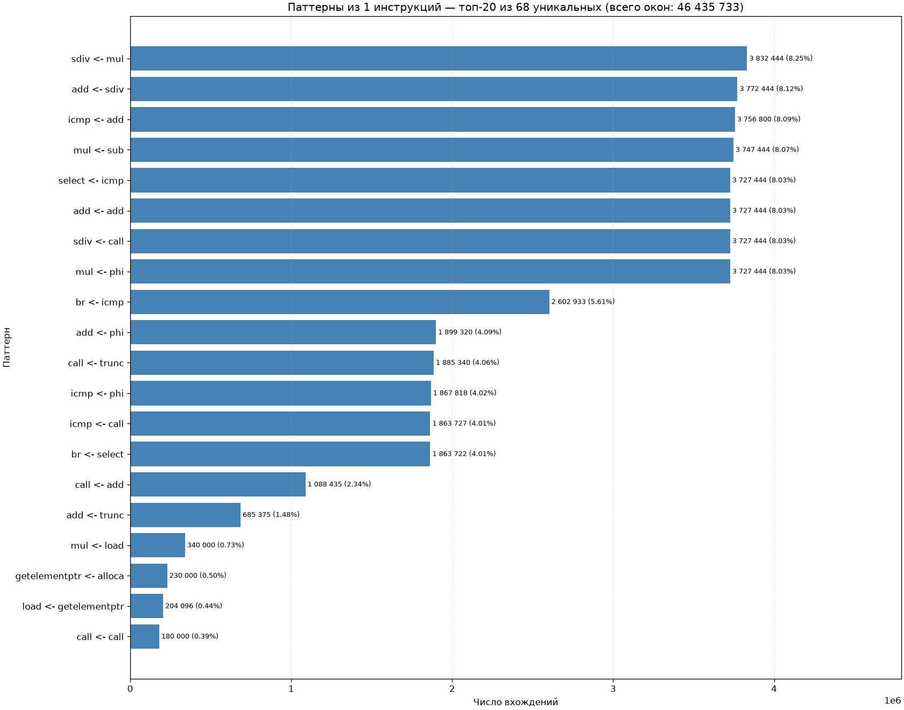
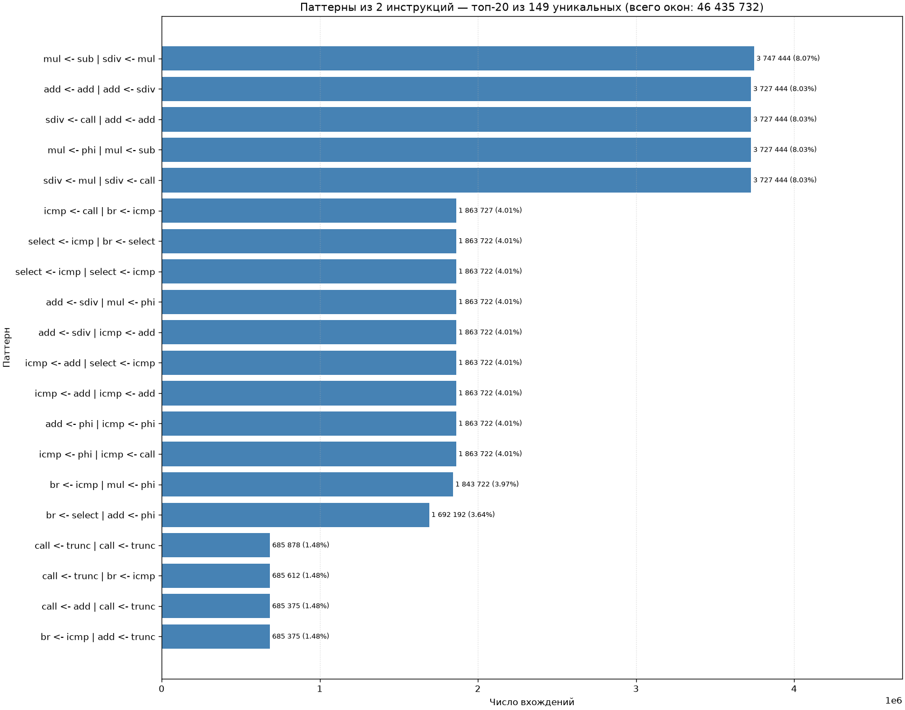
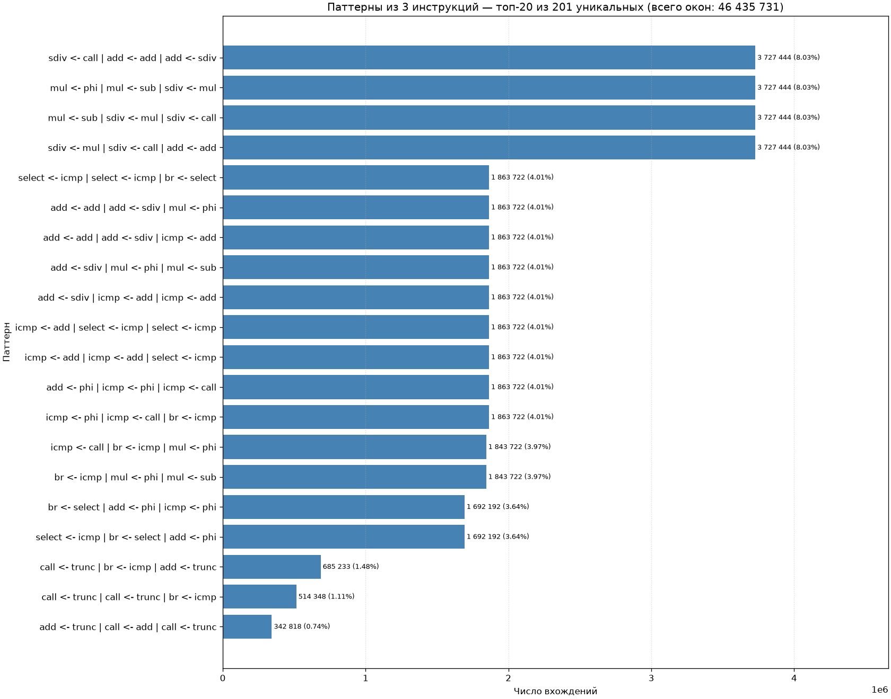
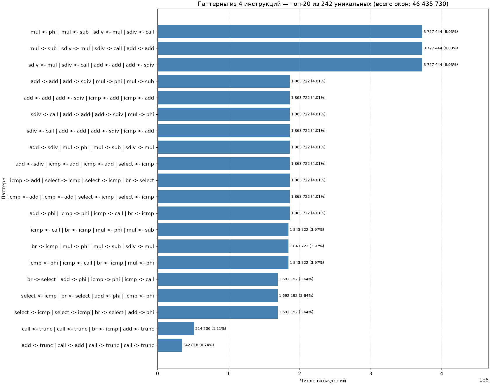
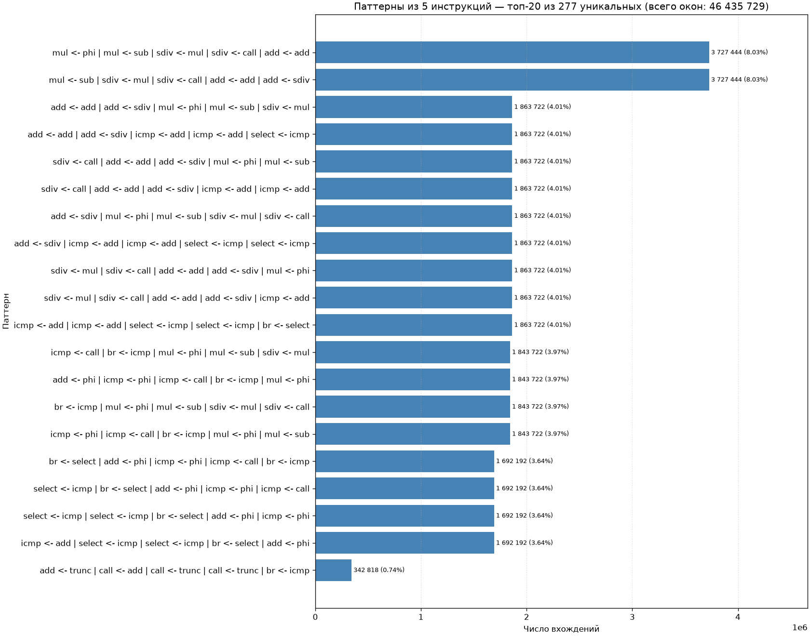

# LLVM instrumentation pass

Плагин (`.so`) с инструментирующим пассом для LLVM.
Пасс привязан к `registerOptimizerLastEPCallback`, т.е. выполняется
в конце пайплайна оптимизаций — уже на оптимизированном IR.

## Сборка

``` bash
clang++ LLVMInstrumentationPass.cpp -fPIC -shared \
        -I$(llvm-config --includedir) -o libLLVMInstrumentationPass.so
```

## Запуск
``` bash
clang -fpass-plugin=./libLLVMInstrumentationPass.so file.c runtime.c -o file
./file                       # печатает лог в stdout
```


## Частые паттерны в приложении

### Паттерн из 1 инструкции


### Паттерн из 2 инструкций


### Паттерн из 3 инструкций


### Паттерн из 4 инструкций


### Паттерн из 5 инструкций
